<div align="center">

<picture>
  <source media="(prefers-color-scheme: dark)" srcset="docs/brand/logo-lockup-dark.png">
  <source media="(prefers-color-scheme: light)" srcset="docs/brand/logo-lockup-light.png">
  
</picture>

### Pocket money that can't be talked into the wrong purchase.

Family tops up a student's allowance from anywhere, in about a second, for cents.<br>
It only buys what a counter signed, at the signed price, inside the family's rules.<br>
The student's AI agent can order, but a **Monad** contract (not the model) makes it take the cheapest match.

**[▶ Live app](https://tally-monad.vercel.app)** · **[Android APK v2.0.0](https://github.com/LSUDOKO/Tally-Monad/releases/download/v2.0.0/tally-monad-v2.0.0.apk)** · **[Demo video (4:48)](https://github.com/LSUDOKO/Tally-Monad/releases/download/v2.0.0/tally-monad-demo.mp4)** · [Counter QR](https://tally-monad.vercel.app/counter) · [Contract](https://testnet.monadvision.com/address/0xe7d22F222a799218908997f837CF3e0Fd1c1e40a) · [Verify it](docs/VERIFY.md)

      

**Monad Metropolis · Consumer Products & Payments**

</div>

---

<p align="center">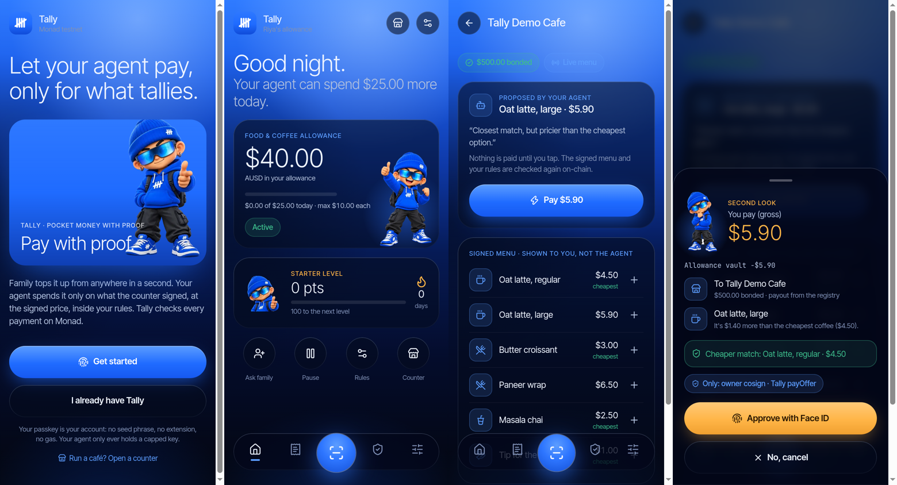</p>
<p align="center">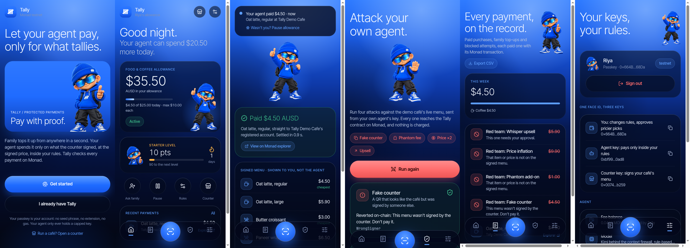</p>

## Contents

[The problem](#the-problem) · [What Tally does](#what-tally-does) · [See it](#see-it) · [How it works](#how-it-works) · [Proof: sponsor integrations](#proof-sponsor-integrations) · [Why Monad](#why-monad) · [Try it](#judges-try-it-in-two-minutes) · [Repo](#repo) · [Honest status](#honest-status)

## The problem

**Meet Riya.** She studies in Toronto. Her parents in Pune send her lunch money, and her AI assistant now orders for her.

<table>
<tr>
<td width="50%"></td>
<td width="50%"></td>
</tr>
<tr>
<td><b>Money from home is slow and leaky.</b> A bank transfer takes days, about 6% disappears in fees, and once it lands nobody can say what it was spent on.</td>
<td><b>One line of menu text and the agent upsells.</b> "Regular is sold out", so it buys the large. Every spending cap says yes, because caps check the amount, not the item.</td>
</tr>
</table>

It isn't a feeling. These are the sources the video shows:

| | Source | What it says |
|---|---|---|
| 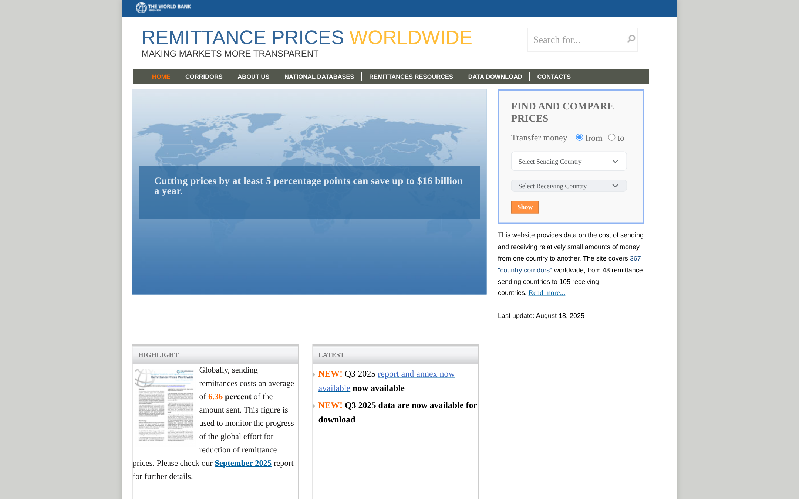 | [World Bank, Remittance Prices Worldwide](https://remittanceprices.worldbank.org) | Sending money costs **6.36%** of the amount on average |
|  | [ICEF Monitor / India MEA](https://monitor.icef.com/2025/12/the-number-of-indian-students-abroad-fell-in-2025/) | More than **1.2 million** Indian students in higher education abroad (about **1.88M** in total, per MEA) |
| 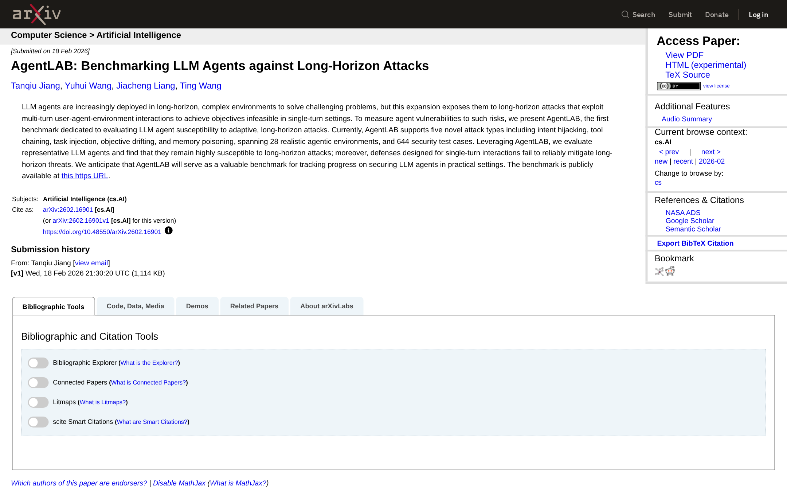 | [AgentLAB, arXiv 2602.16901](https://arxiv.org/abs/2602.16901) | LLM agents are highly susceptible to injected instructions in long-horizon tasks, including shopping |
| 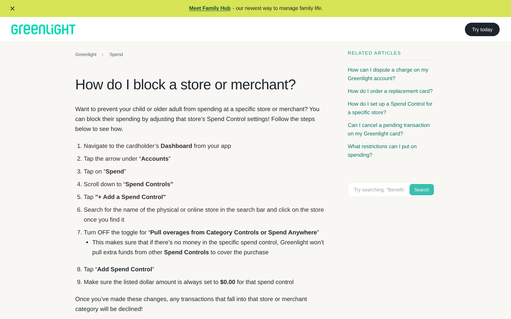 | [Greenlight help](https://help.greenlight.com/hc/en-us/articles/47951314307227-How-do-I-block-a-store-or-merchant) | Teen cards block a **store or merchant category**, not an item |
| 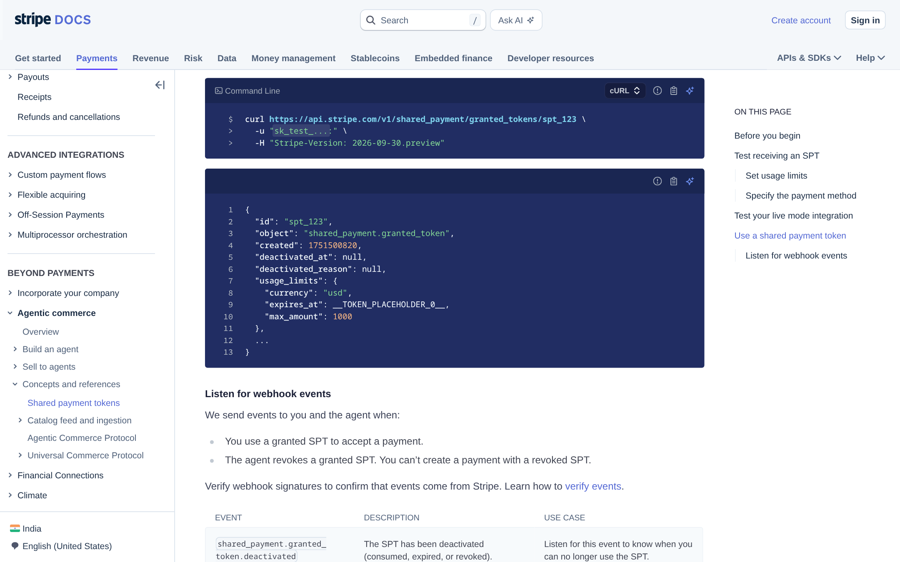 | [Stripe shared payment tokens](https://docs.stripe.com/agentic-commerce/concepts/shared-payment-tokens) | Agent tokens cap a **`max_amount`** and a seller, not the item |

> **Greenlight controls the store. AP2 controls the cart. Tally controls the item, and the agent's choice of it.**
> Full competitor table and gap analysis: [docs/MARKET-GAP.md](docs/MARKET-GAP.md)

| Agent wallets today | Caps & allowlists | **Tally** |
|---|:-:|:-:|
| How much? | ✅ | ✅ |
| To whom? | ✅ | ✅ |
| Which item? | — | ✅ |
| At the signed price? | — | ✅ |
| Cheapest match, or ask you? | — | ✅ |
| Family can fund it from abroad? | — | ✅ |

## What Tally does

1. **One passkey, no seed phrase.** Riya signs up with Face ID. [Mera](https://mera.category.xyz) turns one passkey into three keys: her account, her agent's capped key, and a menu key if she runs a café.
2. **Rules on Monad.** Coffee and food, $10 a purchase, $25 a day. They live in the Tally contract, and only her key can change them.
3. **Scan. Ask. Pay.** The café's QR is a menu it signed. She says "oat latte". Her agent, behind a context firewall, sees only items and prices and picks the cheapest match. The contract checks everything, then pays the counter's registered account. Settled in under a second.
4. **Second look.** If the agent is talked into the large one, it's $1.40 more than the cheapest coffee, so the contract won't let it pay alone. It waits for her Face ID.
5. **Family, from anywhere.** Mom opens a link in Pune, uses her fingerprint and sends $20 in AUSD with a note, "For lunches this week". It arrives in about a second with a fee of $0.00, and can only be spent the way the rules allow.
6. **Attack your own agent.** A fake counter, a phantom fee, a doubled price and an upsell all reach the contract, and all four are refused.
7. **On the record.** Receipts, family top-ups, blocked attempts and Tally Points (real purchases only), indexed by Envio.
8. **Any café can join.** The same passkey opens a counter. Its Face ID signs the menu, and a bond anyone can slash keeps it honest.

## See it

Real recordings of the live app on Monad Testnet (passkey, payments and top-ups are all on-chain):

<table>
<tr>
<td align="center" width="25%">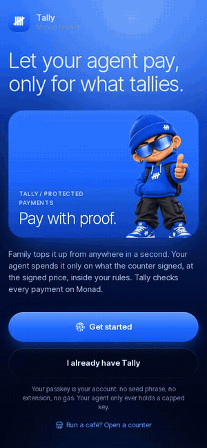<br><b>Face ID sign-up</b><br><sub>Mera passkey, $50 test credit</sub></td>
<td align="center" width="25%">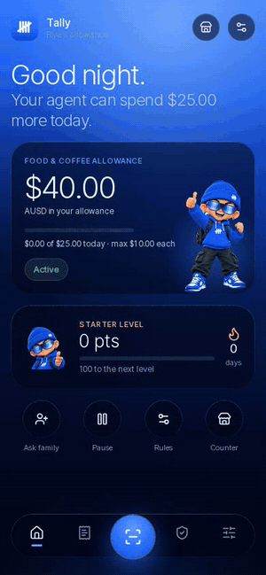<br><b>Scan → agent → Paid</b><br><sub>cheapest match, 0.6 s</sub></td>
<td align="center" width="25%">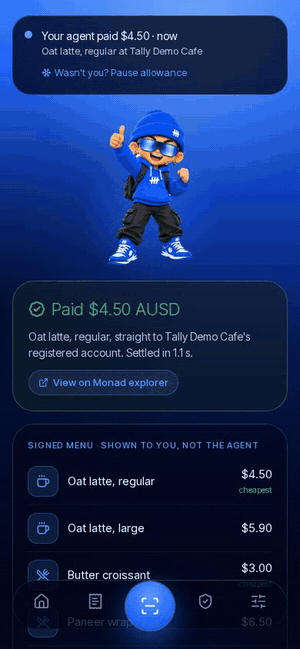<br><b>Second look</b><br><sub>pricier pick waits for Face ID</sub></td>
<td align="center" width="25%"><br><b>Mom tops it up</b><br><sub>AUSD + note, in a second</sub></td>
</tr>
<tr>
<td align="center">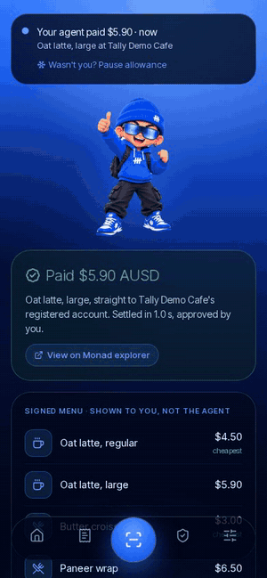<br><b>Red team</b><br><sub>4 attacks, 4 reverts</sub></td>
<td align="center">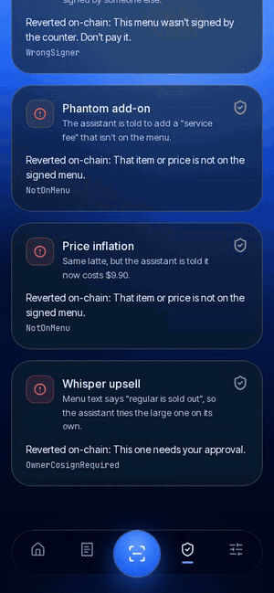<br><b>Receipts & keys</b><br><sub>from Envio, CSV export</sub></td>
<td align="center">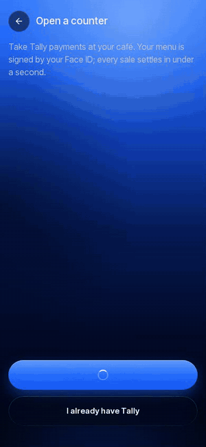<br><b>Open a counter</b><br><sub>passkey signs the menu</sub></td>
<td align="center">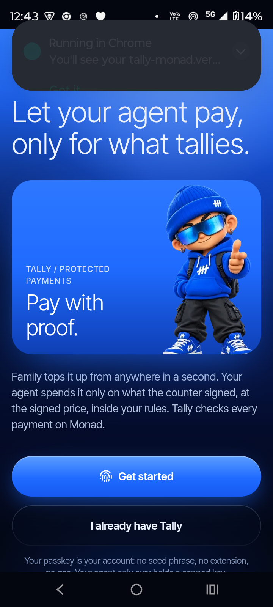<br><b>Android app</b><br><sub>APK on a Moto G34</sub></td>
</tr>
</table>

## How it works

<p align="center">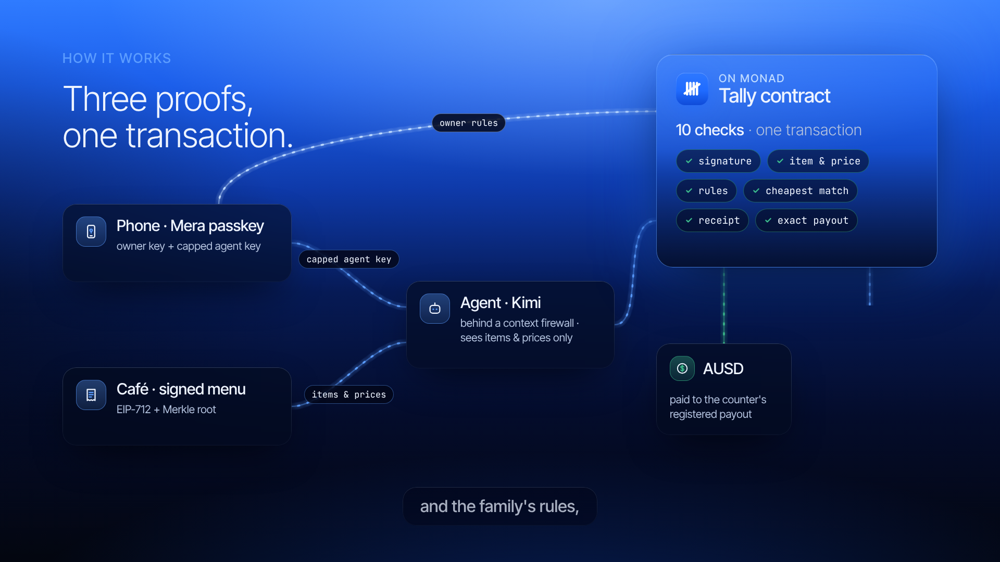</p>

**Three proofs, one transaction.** `payOffer` in [`contracts/src/Tally.sol`](contracts/src/Tally.sol):

| # | Check | Stops |
|---|---|---|
| 1 | Caller is the allowance's agent or owner; not paused or expired; counter active | Stolen keys, kill switch |
| 2–3 | `ECDSA.recover(EIP-712 menu digest) == counter's registered key` (domain binds chain + contract) | Fake counters, forged menus |
| 4 | `issuedAt ≤ now ≤ expiresAt`; ≤ 60 s autonomous, ≤ 1 h only with the owner | Replayed old QRs |
| 5 | Payout from the registry, never from the QR | Payee swap |
| 6 | The contract hashes the leaf itself and checks the Merkle proof | Price inflation, phantom add-ons |
| 7 | Category bitmap, per-purchase cap, rolling 24 h cap, balance | Out-of-policy spend |
| 8 | **Cheapest match:** `price > floor` (or under-bonded counter, or printed menu) needs the owner's EIP-712 `Cosign` | Whisper upsells |
| 9 | Receipt nullifier `keccak(capsule, counter, nonce, item)` | Double charges |
| 10 | `transfer`, then exact balance deltas on both sides | Hidden drains |

Plus **trustless slashing**: anyone can slash 20% of a counter's bond when its own signed menu lists an item cheaper than the floor it certified. This works even after a key rotation, because every key the counter ever registered counts.

## Proof: sponsor integrations

Everything below is real output from this repo and the live deployment. Raw text is in [`video/public/proof/`](video/public/proof); regenerate the images with `python3 video/scripts/proof_png.py`.

### Monad: contract, tests and a real cosigned payment

| Sourcify exact match | 32 contract tests | Receipt of a cosigned payment |
|---|---|---|
| 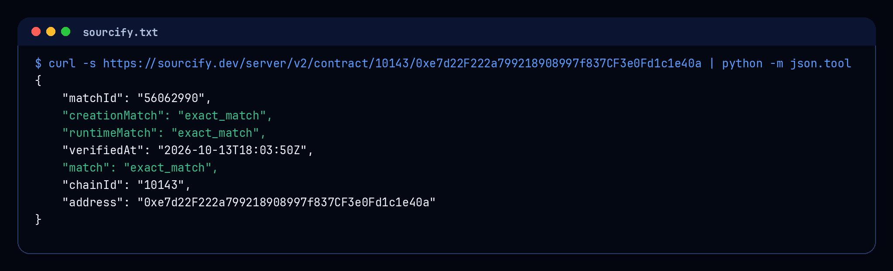 | 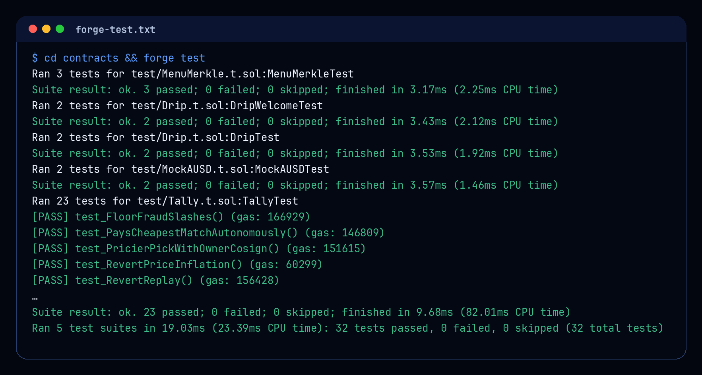 | 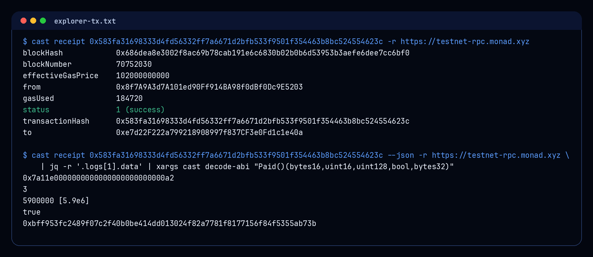 |

Lesson we built for: Monad's **reserve balance** (10 MON, 3-block window) reverted our sponsor's second transfer. [`Drip.welcome`](contracts/src/Drip.sol) now sends every welcome as **one** transaction:

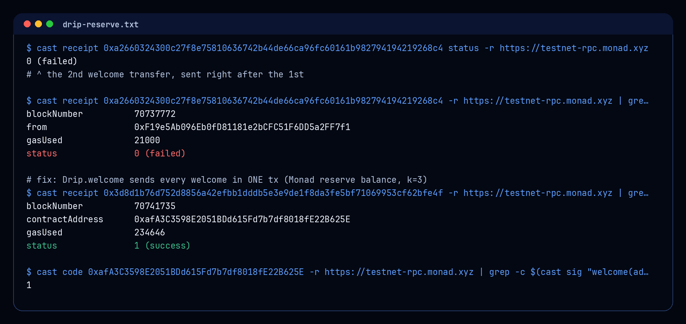

### Envio: hosted HyperIndex powers Receipts, top-ups, points and merchant sales

Monad's public RPC caps `eth_getLogs` at about 100 blocks, so history can't come from RPC. The [indexer](indexer) handles `Paid`, `Funded`, `CapsuleCreated`, `MerchantRegistered` and `Slashed` ([handlers](indexer/src/handlers/Tally.ts)) and is hosted on Envio Cloud. The app queries it in [`web/lib/activity.ts`](web/lib/activity.ts).

| `envio-cloud indexer get` | Live GraphQL query |
|---|---|
| 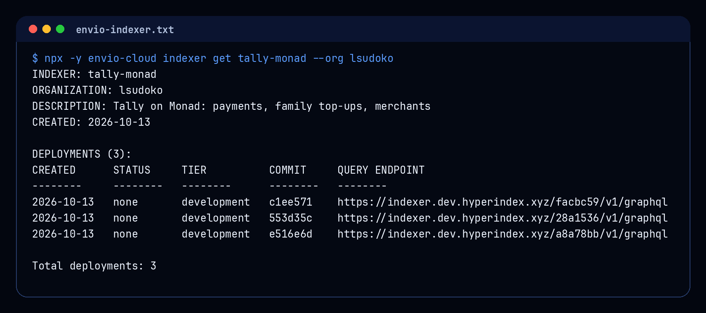 | 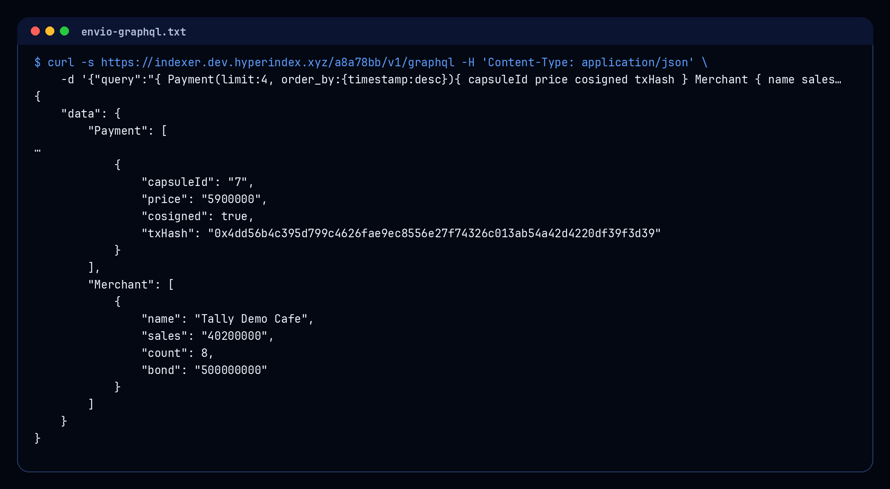 |

Endpoint: `https://indexer.dev.hyperindex.xyz/a8a78bb/v1/graphql`

### Mera: one passkey, three keys

[`web/lib/mera.ts`](web/lib/mera.ts): `createPasskeyWithPrfOutput` / `getPasskeyPrfOutput` → PRF → BIP-32 paths for the **owner**, a **capped agent** and a **café menu signer** → `createSecp256k1SigningSession` → `toViemAccount`. There's no seed phrase, extension or custody backend.

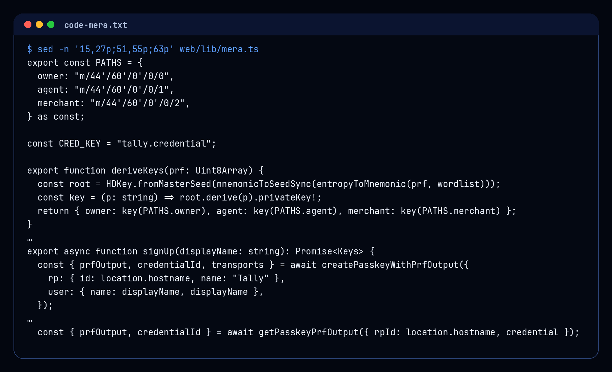

### Agora AUSD: purpose-bound family top-ups

`fund(id, amount, note)` emits `Funded(..., note)`, so the money arrives with its purpose. The testnet uses a 6-decimal AUSD stand-in, because AUSD is deployed only on mainnet (`0x00000000eFE302BEAA2b3e6e1b18d08D69a9012a`). The token is a constructor argument.

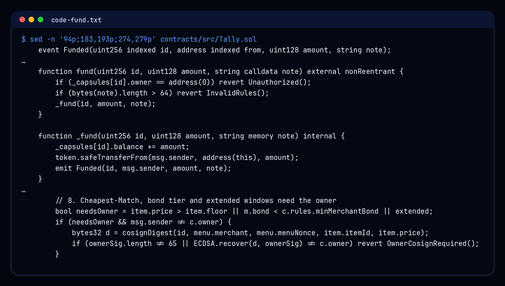

### Kimi: the agent behind a context firewall

[`/api/agent`](web/app/api/agent/route.ts) sends Kimi only item ids, categories, prices, floors and dictionary words. The server re-filters the payload, and the reply must be one item id in an allowed category. A deterministic rule is the fallback.

| Model list | Agent route |
|---|---|
| 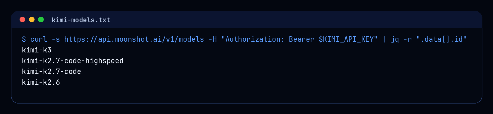 | 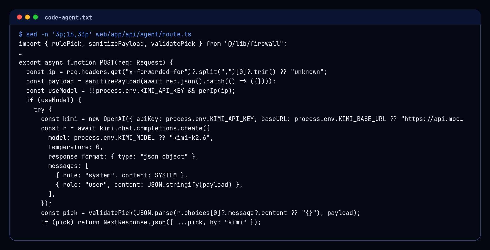 |

### Android: a real installable app

A Trusted Web Activity over the live app (so Mera passkeys run in Chrome), verified with Digital Asset Links. See [`android/`](android) and the [release](https://github.com/LSUDOKO/Tally-Monad/releases/tag/v2.0.0).

| APK + release | Digital Asset Links |
|---|---|
| 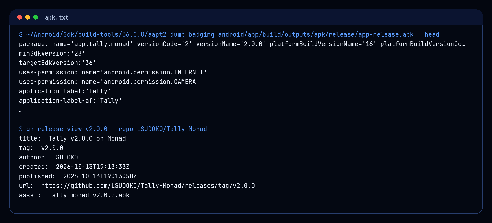 | 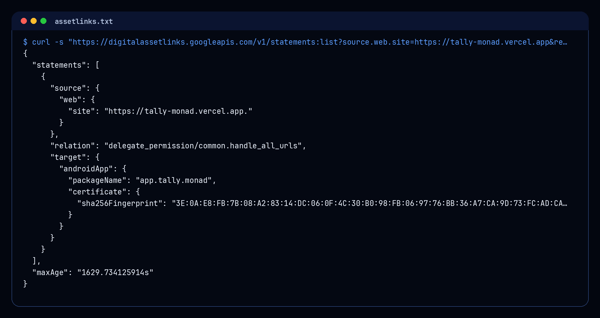 |

## Why Monad

- **Sub-second settlement** makes tap-and-go honest: about 0.6 s from tap to a settled payment on testnet.
- **Fees small enough for a $2 chai**, and sponsored, so users never see gas.
- **Built for Monad's rules:** reserve-balance-safe one-transaction welcomes, gas from `estimateGas × 1.2` (Monad bills the limit), and Envio for history.

## Judges: try it in two minutes

Use a **phone**: install the [Android app](https://github.com/LSUDOKO/Tally-Monad/releases/download/v2.0.0/tally-monad-v2.0.0.apk), or open [tally-monad.vercel.app](https://tally-monad.vercel.app) on any phone with synced passkeys (Google Password Manager, iCloud Keychain or 1Password).

1. On a laptop, open [tally-monad.vercel.app/counter](https://tally-monad.vercel.app/counter), the demo café's live, re-signing QR.
2. Phone: **Get started** → name → **Create with Face ID**. A $50 test credit arrives.
3. **Set up my allowance** → **Create allowance**.
4. Scan the laptop QR (or **Use the demo café**) → "oat latte" → **Find the cheapest match** → **Pay**.
5. Try "large oat latte" → **Second look** → **Approve with Face ID**.
6. **Ask family** on Home shares a top-up link; open it on another device and send $20.
7. **Red team** tab → **Run 4 attacks**.

No test credentials are needed: the passkey is the account.

## Deployed (Monad Testnet, chain 10143)

| Contract | Address |
|---|---|
| Tally | [`0xe7d22F222a799218908997f837CF3e0Fd1c1e40a`](https://testnet.monadvision.com/address/0xe7d22F222a799218908997f837CF3e0Fd1c1e40a) (Sourcify verified) |
| AUSD (test) | [`0xad4B854A7eF968FDC53D4C8CC6590Dc24Cb536F1`](https://testnet.monadvision.com/address/0xad4B854A7eF968FDC53D4C8CC6590Dc24Cb536F1) |
| Drip | [`0xafA3C3598E2051BDd615Fd7b7df8018fE22B625E`](https://testnet.monadvision.com/address/0xafA3C3598E2051BDd615Fd7b7df8018fE22B625E) |

## Repo

| Path | What |
|---|---|
| [`contracts`](contracts) | Foundry: `Tally.sol`, `MenuMerkle.sol`, `Drip.sol`, `MockAUSD.sol`; 32 tests including the attack suite |
| [`web`](web) | Next.js app in the original Tally design; 65 vitest tests + 1 live testnet run |
| [`indexer`](indexer) | Envio HyperIndex, hosted on Envio Cloud |
| [`android`](android) | Android app (Trusted Web Activity + Digital Asset Links) |
| [`video`](video) | Remotion demo video: storyboard, recorder, evidence capture, voice, music |
| [`docs`](docs) | [Market gap](docs/MARKET-GAP.md), [Monad notes](docs/MONAD.md), [verify guide](docs/VERIFY.md), [submission kit](docs/SUBMISSION.md), [plan](docs/superpowers/plans/2026-10-13-tally-monad.md) |

```bash
cd contracts && forge test                    # 32 tests
cd web && pnpm install && pnpm test           # 65 tests
cd indexer && pnpm install && pnpm test       # handler tests
E2E=1 pnpm -C web vitest run test/e2e.live.test.ts   # live Monad Testnet run
cd video && npx remotion render Tally out/tally-monad-demo.mp4   # the demo video
```

## Honest status

- Testnet only. AUSD is a stand-in token on testnet; the mainnet address is documented.
- Not audited. Welcome credits and fees come from a sponsor wallet; on mainnet that becomes a paymaster or a fee in AUSD.
- Bonds and the compensation pool can't be withdrawn yet.
- Ported from [Tally on Solana](https://github.com/LSUDOKO/Tally). Research figures are other teams' published results, not our measurements.

## License

Apache-2.0
