<div align="center">

<picture>
  <source media="(prefers-color-scheme: dark)" srcset="docs/brand/logo-lockup-dark.png">
  <source media="(prefers-color-scheme: light)" srcset="docs/brand/logo-lockup-light.png">
  
</picture>

### Let your agent pay, only for what tallies.

An AI agent may pay only for an item a merchant signed, at the signed price, to the registered merchant, inside your rules.<br>
A Solana program checks every payment, and anything else reverts.

[](https://github.com/LSUDOKO/Tally/actions/workflows/ci.yml)


[](https://github.com/LSUDOKO/Tally/releases/latest)
[](LICENSE)
[](CODE_OF_CONDUCT.md)


Built for **CLOCK IN, the Solana Mobile Hackathon** (Mobile track)

**▶ [Watch the demo video](https://youtu.be/Bj0FDTXTpZA)** · **[Verify it yourself](docs/VERIFY.md)** · **[Download the APK (v1.2.0)](https://github.com/LSUDOKO/Tally/releases/download/v1.2.0/tally-v1.2.0-devnet.apk)**

[Whitepaper](docs/00-whitepaper.md) · [v3 plan](docs/24-v3-plan.md) · [Brand kit](docs/brand/README.md) · [Threat model](docs/11-threat-model.md) · [Test suite map](tests/litesvm/THREAT_SUITE.md) · [Demo script](docs/14-demo-script.md) · [Real-phone run](docs/21-real-phone-run.md)

</div>

---

## Demo video

[](https://youtu.be/Bj0FDTXTpZA)

## Verify it yourself

Every claim here maps to something you can run, open on the explorer, or read in the code. **[docs/VERIFY.md](docs/VERIFY.md)** has the full audit trail. In short:

| Claim | How to check it |
|---|---|
| The program is deployed and enforces ten invariants | [Program on Explorer](https://explorer.solana.com/address/3ofJTv8xX68aFTQJLNZV2tDXESPuCjcfRHpeLd37djqk?cluster=devnet) · [code map](docs/VERIFY.md#4-code-map-the-ten-invariants) |
| Attacks revert with exact errors | [Payee swap, 2001](https://explorer.solana.com/tx/4eCo3iQviYdcfnjLxqyETCoWZTCqFskQX3uBieXeEeR9vNfVPVwK2wcQnEQ75As8p7Qw6TkyvmejuAtLN6XBvPCE?cluster=devnet) · [phantom add-on, 6009](https://explorer.solana.com/tx/4oot9a8F18zqqAFXjK6ntL7uKEh8s93LuaMMBqqb5shNwtqbUE8GUdsQpaghyAjH7sosj2wdoRm6yPDwbsxDx8NS?cluster=devnet) · [all evidence](#on-chain-evidence-devnet) |
| It all builds and passes tests | [CI on every push](https://github.com/LSUDOKO/Tally/actions/workflows/ci.yml): 155 Rust · 19 TS · 97 Kotlin · 16 cloud, [commands and expected counts](docs/VERIFY.md#2-run-the-tests-expected-counts) |
| It runs on a real phone with a real wallet | [Demo video](https://youtu.be/Bj0FDTXTpZA) · [APK v1.2.0](https://github.com/LSUDOKO/Tally/releases/tag/v1.2.0) · [co-signed in Solflare on devnet](https://explorer.solana.com/tx/58ePPqG3hK7TWYzXYtsoJXn5iSaNYX2tN8R67uzRhs2TA3esUx8Nb1CQPNqoAag7bxhcTwg2fgNWKLtzBbaHEGyD?cluster=devnet) |

**Shipped vs. not:** the program, app, merchant mode and cloud are shipped and on devnet. The research numbers below (73.3%, 140 → 0) are **other teams' published results** that motivated the design, not our measurements. **Not done yet:** a security audit, mainnet, and merchant pilots ([honest status](docs/VERIFY.md#6-merchant-adoption-honest-status)). On devnet, SKR and the Seeker Genesis Token are mock mints from our faucet.

## Why

AI agents can now pay on our behalf, and today they're protected with spending caps and allowlists. 2026 research shows the real attack is not stealing a large amount. It's **one sentence of merchant text talking the agent into the wrong item**: a pricier listing (steered **73.3%** of the time in *Signing the Transaction but Not the Decision*, arXiv 2609.11757), an add-on nobody showed, or a different payee. Those carts are well-formed, under the cap and signed by an authorised key, so every perimeter check passes. Across 14 models, only a deterministic check outside the model stopped bad transfers: **140 → 0** (APort Vault, arXiv 2609.22076).

Caps answer *how much*. Allowlists answer *to whom*. **Tally answers *which item, at which signed price, from which registered merchant*, and asks you when the agent picks the pricier one.**

*Spending limits protect your balance. Tally protects your decision.*

## See it

Real recordings from a Moto G34 with Solflare on devnet. Waits are sped up; nothing is staged.

<table>
<tr>
<td align="center" width="33%">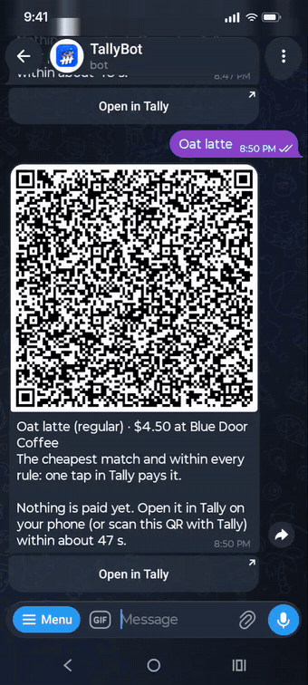<br><b>Telegram → Paid</b><br><sub>TallyBot finds the cheapest match your rules allow; one tap, the chain checks it, Paid 4.50 USDC.</sub></td>
<td align="center" width="33%">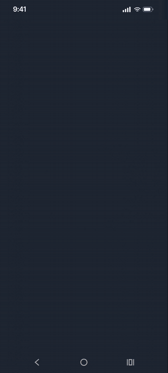<br><b>Second Look → Paid</b><br><sub>The large latte is pricier than the cheapest match, so Tally waits for your signature in Solflare.</sub></td>
<td align="center" width="33%">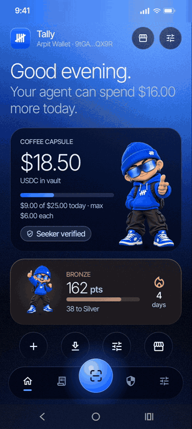<br><b>Scan → pay</b><br><sub>The camera reads the counter's signed menu, the agent picks the cheapest match, Tally pays and notifies you.</sub></td>
</tr>
<tr>
<td align="center">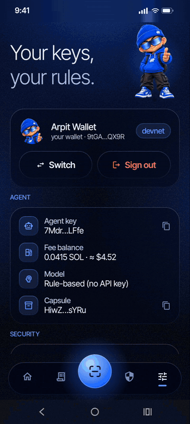<br><b>Sign in with your wallet</b><br><sub>Sign out, pick Solflare from the phone's wallets, Sign in with Solana, back Home.</sub></td>
<td align="center">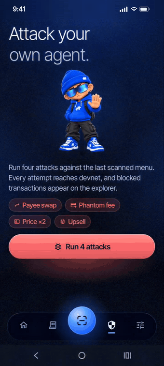<br><b>Red team</b><br><sub>Four attacks against your own agent, each sent to devnet and reverted.</sub></td>
<td align="center">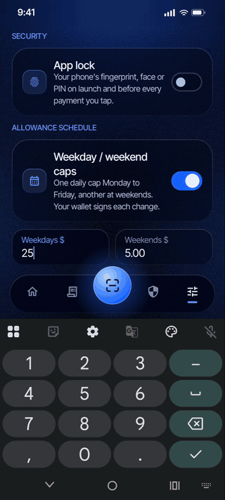<br><b>Weekday allowance</b><br><sub>$25 on weekdays, $5 at weekends; Home asks the wallet once when the day type changes.</sub></td>
</tr>
<tr>
<td align="center">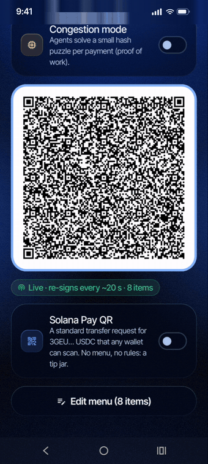<br><b>Merchant mode</b><br><sub>The same APK runs the counter: a live signed-menu QR, plus a Solana Pay QR for any wallet.</sub></td>
<td></td><td></td>
</tr>
</table>

## How it works

<p align="center">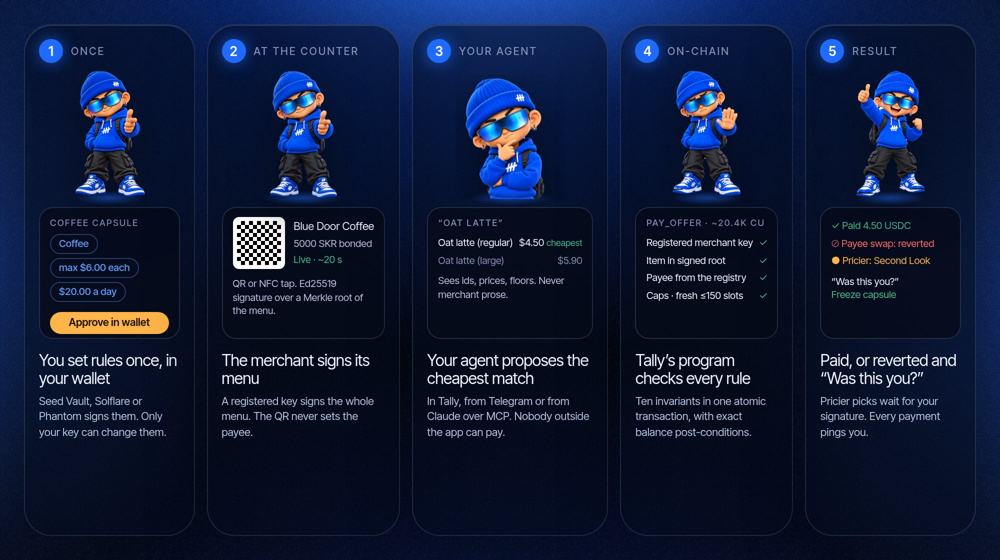</p>

1. **You set rules once in your wallet.** Categories, per-purchase and daily caps, merchant bond tier and expiry, in a capsule only your key can change.
2. **The merchant signs its menu.** A rotating QR or an NFC tap carries a menu signed by the merchant's registered key.
3. **Your agent proposes the cheapest match.** Behind a context firewall it sees item ids, categories, prices and floors, never merchant prose.
4. **Tally's program checks every rule on-chain.** One atomic transaction binds three proofs:
   - **Merchant proof.** A 144-byte menu header signed by the merchant's registered Ed25519 key, plus a Merkle proof for the chosen item.
   - **Intent proof.** A **capsule** PDA holding your rules, which only your wallet key can change.
   - **Execution proof.** Instructions-sysvar introspection with hardened Ed25519 offsets, then exact balance post-conditions.
5. **Paid, or reverted and "Was this you?".** Pricier picks wait for your signature (Second Look); every agent payment sends a notification with a Freeze button.

## Screens

<p align="center">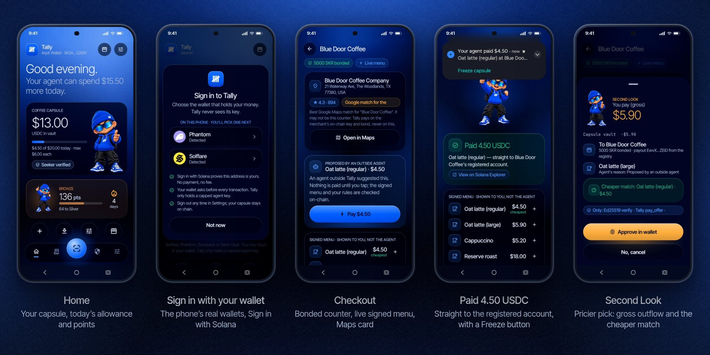</p>
<p align="center">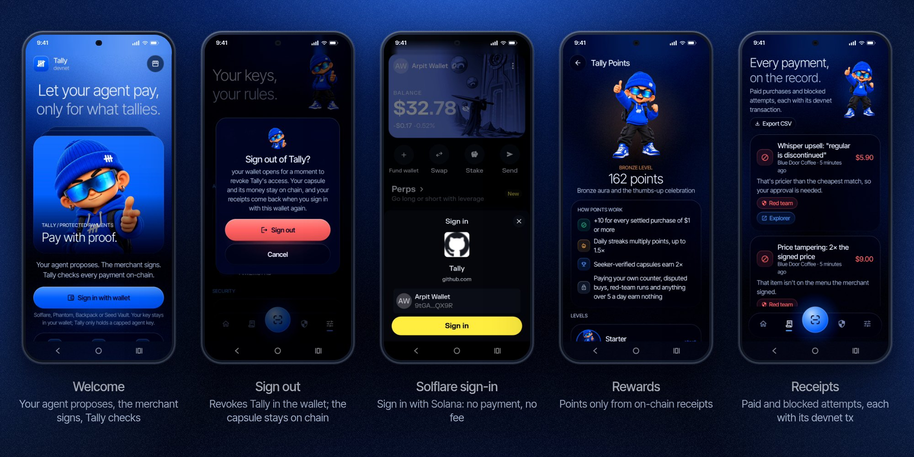</p>
<p align="center">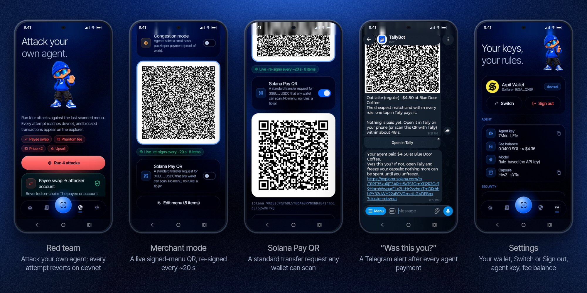</p>

Single screens: [Welcome](docs/images/readme/screens/welcome.jpg) · [Wallet picker](docs/images/readme/screens/signin.jpg) · [Solflare sign-in](docs/images/readme/screens/solflare_signin.jpg) · [Account card](docs/images/readme/screens/account.jpg) · [Sign out](docs/images/readme/screens/signout.jpg) · [Home](docs/images/readme/screens/home.jpg) · [Telegram offer](docs/images/readme/screens/telegram.jpg) · [Checkout](docs/images/readme/screens/checkout.jpg) · [Paid](docs/images/readme/screens/paid.jpg) · [Second Look](docs/images/readme/screens/secondlook.jpg) · ["Was this you?"](docs/images/readme/screens/alert.jpg) · [Red team](docs/images/readme/screens/redteam.jpg) · [Receipts](docs/images/readme/screens/receipts.jpg) · [Rewards](docs/images/readme/screens/rewards.jpg) · [Settings](docs/images/readme/screens/settings.jpg) · [Weekday allowance](docs/images/readme/screens/allowance.jpg) · [Signed-menu QR](docs/images/readme/screens/menuqr.jpg) · [Solana Pay QR](docs/images/readme/screens/solanapay.jpg) · [Camera scan](docs/images/readme/screens/scan.jpg)

## Features

| Feature | What it does |
|---|---|
| **Sign in with your wallet** | Lists the wallets on your phone (Solflare, Phantom, Backpack, Seed Vault) with their own icons and signs in with Solana. No password, no fee; the session is remembered, and **Sign out** or **Switch** in Settings revokes it. Each account's receipts and points stay separate on a shared phone. |
| **Capsule** | Your rules (categories, per-purchase and daily caps, merchant bond tier, expiry) and a USDC vault, signed once in Seed Vault. Only your key can change them. |
| **Signed menus** | QR or NFC. The merchant's registered key signs the menu; the program verifies it and the Merkle proof for the item you pay for. |
| **Agent** | Groq-hosted model or a rule-based fallback, behind a context firewall: it sees item ids, categories, prices and floors, never merchant prose. |
| **Second Look** | Anything pricier than the cheapest match, from an under-bonded merchant or on a long-lived menu stops for your signature, with the gross outflow shown. |
| **Red team** | Four attacks against the last scanned menu, each reaching devnet and reverting with its exact error. |
| **"Was this you?"** | A notification after every agent payment with a Freeze button, also on the home-screen widget, and a Telegram message even when the app is closed (Helius webhooks). |
| **Allowance schedule** | One daily cap on weekdays and another at weekends; Home asks for one wallet approval when the day type changes. |
| **App lock** | Your phone's fingerprint, face or PIN on launch and before every payment you tap. |
| **Points and levels** | 10 points per settled purchase, streak multiplier, 2× for Seeker-verified capsules. Only on-chain receipts count; nothing can be bought or transferred. |
| **My usual, cart, this week** | One-tap reorder (only if the fresh menu matches), several items reviewed together, a weekly summary with a spend-by-category bar. |
| **Receipts** | Every payment and blocked attempt with its explorer link; share one, or export them all as CSV. |
| **Counter directory** | Every registered merchant on the cluster with bond, slash history and open disputes, read from chain before you scan, with its Google Maps place. |
| **Merchant mode** | The same APK runs a counter: register with an SKR bond, broadcast a signed menu over QR and NFC, plus a standard Solana Pay QR for wallets without Tally. |
| **Offline** | Rules, receipts and the last balance stay readable; payments always need a fresh signed menu. |

### New in v3

| Feature | Where |
|---|---|
| **Wallet sign-in, sign out, switch**: a wallet picker with the phone's real wallets, Sign in with Solana, a remembered session | Home, Settings |
| **Payment alerts in Telegram**: `/wallet` gives your chat its own Helius webhook on your capsule; every purchase, top-up and withdrawal arrives as a message naming the counter, even with Tally closed | Telegram bot |
| **Counter places**: the counter's Google Maps name, address, rating and photo at checkout and in the directory (the key stays on the cloud; a name match is labelled as one) | Checkout, Scan |
| **Weekday / weekend allowance**: different daily caps, applied with one wallet approval | Settings, Home |
| **App lock**: fingerprint, face or PIN on launch and before every payment you tap | Settings |
| **Fee balance in dollars** (Jupiter price feed) · **CSV export** · **spend by category** | Settings, Receipts, Rewards |
| **Counter directory** from the program's accounts · **Solana Pay QR** for merchants | Scan, Merchant mode |
| **Public capsule page** (`/c/<owner>`) and the bot's `/share` | Tally cloud, Telegram |

Everything above runs on devnet today. What needs a key and where it lives is in the [v3 plan](docs/24-v3-plan.md).

## Architecture

<p align="center">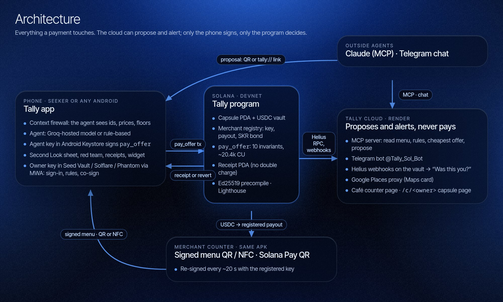</p>

- **Phone (Tally app).** Context firewall, agent (Groq-hosted model or rule-based), agent key in Android Keystore; the owner key stays in Seed Vault, Solflare or Phantom and is reached through Mobile Wallet Adapter.
- **Tally program (Solana).** Capsule and USDC vault, merchant registry with SKR bond, `pay_offer` with ten invariants, receipts. USDC only ever moves to the registered payout.
- **Merchant counter.** The same APK in Merchant mode: a signed menu over QR and NFC, re-signed every ~20 s, plus a standard Solana Pay QR.
- **Tally cloud.** MCP server, Telegram bot, Helius webhooks for "Was this you?" alerts, Google Places proxy, the café counter and capsule pages. It can propose and alert; it cannot pay.
- **Outside agents.** Claude or any MCP client, and Telegram chats, reach the app only as proposals.

Specs: [docs/05](docs/05-architecture.md) (architecture) · [docs/06](docs/06-onchain-program.md) (program).

## On-chain invariants: `pay_offer`

| # | Invariant | Blocks |
|---|---|---|
| 1 | Agent signer, capsule not frozen or expired, merchant active | Stolen or rotated keys, kill switch |
| 2 | The previous instruction is the native Ed25519 precompile (sysvar introspection) | Missing or forged signatures |
| 3 | **Offset hardening**: one signature, every `*_instruction_index == u16::MAX`, offsets ≥ 16, strict bounds, message == rebuilt header | The precompile offset-hijack bug class *(mutation-verified: with the pin removed, the exploit transaction succeeds)* |
| 4 | Fresh slot window ≤150 slots (~60 s); longer windows need your co-sign | Stale QR replay |
| 5 | Payout = the merchant's **registered** account (never from the QR) | Payee swap |
| 6 | The program hashes the leaf itself; Merkle inclusion under the signed root | Price tampering, phantom add-ons |
| 7 | 256-category bitmap, per-purchase cap, rolling ~24 h cap | Out-of-policy spend |
| 8 | **Cheapest-Match:** price > category floor, under-bonded merchant, or extended window → owner co-sign | Whisper upsells (surfaced to you) |
| 9 | Receipt PDA `(capsule, merchant, menu_nonce, item_id)` is `init` | Double charges |
| 10 | `transfer_checked`, then `vault Δ == −price` and `payout Δ == +price`; optional exact Lighthouse assertion | Hidden drains, fee-on-transfer mints, state drift |

Also on-chain: an **SKR merchant bond** (no bond means no autonomy), **trustless fraud-proof slashing** (anyone can slash a merchant whose own signed menu contradicts its certified floor), arbiter disputes, a **Seeker Genesis Token** check for Seeker-only promos, and a merchant-enabled **proof-of-work anti-flood gate**. Details are in [docs/06](docs/06-onchain-program.md).

`pay_offer` costs about **20.4k compute units** (about 22.8k with a 4,096-item menu; target < 45k).

## What's in the repo

| Path | What |
|---|---|
| [`programs/tally`](programs/tally) | Anchor 1.2 program: 24 instructions |
| [`crates/tally-core`](crates/tally-core) | Byte-level primitives shared by the program and tests (header, leaves, Merkle, hardened Ed25519 parsing, post-conditions, PoW) |
| [`tests/litesvm`](tests/litesvm) | Threat-model suite: every on-chain attack in [docs/11](docs/11-threat-model.md) asserts its exact revert ([map](tests/litesvm/THREAT_SUITE.md)) |
| [`fixtures`](fixtures) | Cross-language vectors: Rust, TypeScript and Kotlin must reproduce every byte |
| [`sdk`](sdk) | TypeScript SDK (`@solana/kit` + Codama client), menu signing, `pay_offer` builder, error sentences |
| [`scripts`](scripts) | Deploy, initialise a cluster, seed the demo world, replay the attacks with explorer links, faucet |
| [`app`](app) | Android app (Kotlin + Compose): Seeker user mode **and** merchant terminal in one APK |
| [`docs`](docs) | Whitepaper, specs, threat model, research, demo script, deck outline, plans |

## Live demo (Tally cloud)

- **Café counter:** https://tally-cloud-b792.onrender.com/counter (scan with Tally)
- **MCP server:** `claude mcp add --transport http tally https://tally-cloud-b792.onrender.com/mcp`
- **Telegram:** [@Tally_Sol_Bot](https://t.me/Tally_Sol_Bot): `/wallet <your address>`, then "oat latte"; `/share` gives a link to your capsule's rules. After `/wallet`, the bot messages you whenever money moves in your capsule.
- **Counter place:** `https://tally-cloud-b792.onrender.com/places/merchant/<merchant address>`: the counter's Google Maps match
- **Capsule page:** `https://tally-cloud-b792.onrender.com/c/<owner address>`: a capsule's rules, read live from chain

Free-tier hosting: the first request after ~15 idle minutes takes about 30–50 s while the service wakes.

## Agents outside Tally (MCP)

The [Tally MCP server](mcp/README.md) lets Claude or any MCP client read a counter's menu (signature verified on-chain), check it against your capsule's rules, and **propose** a purchase as a QR code or `tally://` link. Proposals only pre-fill checkout: you tap to pay, pricier picks still go through Second Look, and the chain re-checks everything. The server has no way to pay, withdraw, change rules or see keys.

## Try it in 5 minutes

### On your phone (judges)

1. Install **Solflare** (or Phantom) and switch it to **Devnet** (Solflare: Settings → Network → Devnet). A fresh wallet is best.
2. Install the latest `tally-*.apk` from [Releases](https://github.com/LSUDOKO/Tally/releases).
3. Get test funds: [open a "Request devnet test funds" issue](https://github.com/LSUDOKO/Tally/issues/new?template=devnet-test-funds.yml) with your wallet address (tick the box for a test Seeker Genesis Token). These tokens are devnet-only and worthless.
4. In Tally: **Sign in with wallet** (pick Solflare or Phantom and approve "Sign in") → **Create a capsule** (approve) → **Top up agent with 0.05 SOL** (approve).
5. Pay: **Scan or tap to pay** and scan the live counter QR. Ask for "oat latte" (pays on its own) and then "large oat latte" (Second Look asks you to approve in the wallet). Then open **Red team** and watch four attacks revert on-chain.

The counter QR comes from `npx tsx scripts/counter.ts` (a laptop showing the demo café's menu, re-signed every 20 s), or from a second phone in **Merchant mode**. Optional: paste a Groq API key in Settings to use the hosted agent; without one, the built-in rule agent decides.

### Program

```bash
cargo build-sbf --manifest-path programs/tally/Cargo.toml
cargo test --workspace
```

Requires Rust 1.97.1 (pinned) and Solana CLI 4.0.x.

### Local end-to-end (no devnet SOL needed)

```bash
solana-test-validator --reset \
  --bpf-program 3ofJTv8xX68aFTQJLNZV2tDXESPuCjcfRHpeLd37djqk target/deploy/tally.so \
  --bpf-program L2TExMFKdjpN9kozasaurPirfHy9P8sbXoAN1qA3S95 fixtures/programs/lighthouse.so
pnpm install
cd scripts
TALLY_CLUSTER=localnet npx tsx init-devnet.ts   # mints, SGT collection, config
TALLY_CLUSTER=localnet npx tsx seed-demo.ts     # merchant + SKR bond, SGT-verified capsule
TALLY_CLUSTER=localnet npx tsx attack-demo.ts   # honest pay + attacks, with reverts
```

### Devnet

```bash
./scripts/deploy-devnet.sh
cd scripts && npx tsx init-devnet.ts && npx tsx seed-demo.ts && npx tsx export-app-config.ts
npx tsx faucet.ts <your-phone-wallet-address>   # SOL, test USDC, mock SKR for the demo
npx tsx attack-demo.ts                          # writes docs/DEVNET.md
```

### Android

Download the APK from [Releases](https://github.com/LSUDOKO/Tally/releases), or build it yourself:

```bash
cd app && ./gradlew :app:assembleDebug   # app/app/build/outputs/apk/debug/app-debug.apk
```

On a Seeker: **Sign in with wallet** (Seed Vault) → **Create a capsule** ("Coffee, max $6, $15 a day…") → on a second phone open **Merchant mode**, register with an SKR bond and broadcast → **Scan or tap** → "oat latte" → pay. Then open **Red team**.

**One phone or an emulator:** debug builds have a *Demo owner* switch in Settings (a local key in place of Seed Vault; release builds never include it). Fund that address with `npx tsx faucet.ts <address>`, register it in **Merchant mode**, then use **Scan or tap → Pay this phone's merchant menu (demo)**. The phone signs a fresh menu as the merchant and pays it as the customer, so the whole flow runs on real devnet transactions: purchases, the Second Look co-sign, red team, disputes, freeze, rotation, Lighthouse and proof-of-work mode.

**Any Android phone, real wallet:** Tally talks to whatever wallet answers Mobile Wallet Adapter, which is Seed Vault on a Seeker and Solflare or Phantom elsewhere. The full flow (connect, capsule, top-up, merchant registration, autonomous purchase, the co-signed Second Look purchase, red team) has been run on a Moto G34 with Solflare on devnet. Co-signing checks the wallet's capabilities and uses sign-only or sign-and-send, whichever the wallet offers. To try the Seeker-only features without a Seeker, `npx tsx faucet.ts <address> 0 0 0 --sgt` issues a devnet Seeker Genesis Token from our mock collection; close and recreate the capsule (Settings → Close capsule) to get the verified badge and the promo.

**NFC without two NFC phones:** `NfcExchangeTest` runs a software tap, with the reader and the merchant's HCE responder exchanging the exact APDUs the radio would carry; the signed menu arrives byte for byte and still verifies. Each tap reads from a menu snapshot taken at SELECT, so the terminal's 20-second re-sign can't splice two menus, and the reader refuses stalled terminals and menus over 16 KB. QR carries the same signed bytes and works on every phone.

Optional: paste your own Groq API key in **Settings** to use a hosted model (`openai/gpt-oss-120b` on Groq) as the agent. The key stays in app-private storage and is never built into the APK, and the app makes at most 30 model calls a day. Without a key, a deterministic rule-based agent is used. Either way the model only ever sees item ids, categories, prices, floors and dictionary-filtered name tokens, never merchant prose.

## Tests

| Suite | Count | What it proves |
|---|---|---|
| `cargo test --workspace` | **155** | Core vectors + 119 LiteSVM integration tests against the compiled `.so` (exact error codes, real Token-2022 SGT accounts, real mainnet Lighthouse program) |
| `pnpm -C sdk test` | **19** | TS byte parity with Rust; canonical instruction order; generates `fixtures/tx-v1.json` and the per-instruction `fixtures/ix-v1.json` |
| `./gradlew :core:test` (in `app/`) | **97** | Kotlin byte parity with Rust **and** `@solana/kit` (every instruction the app builds, PDAs, compiled message); context firewall and the exact HTTP body sent to the hosted model; a software NFC tap carrying a real signed menu; Second Look; points, streaks and levels; weekly summary; the usual-order guard; cart limits; agent proposals (including one made by the SDK); the weekday/weekend allowance schedule. One opt-in test (`TALLY_LIVE=1`) pays, and is attacked, on devnet through the Kotlin client |
| `pnpm -C mcp test` | **16** | The MCP server's policy (category mask, per-purchase and daily limits with the cycle reset, frozen and expired capsules, approval cases, best match), the Telegram bot, payment-alert wording and Helius webhook handling, and the Places proxy (cache, pins, photo allow-list) |

The demo flow was also run end to end against `solana-test-validator`. The honest purchase pays; the payee swap, phantom add-on and stale menu revert with the expected codes; the Whisper upsell stops for co-sign; the owner-approved purchase pays.

## On-chain evidence (devnet)

Every claim above can be checked on the explorer. The first six rows come from the scripted demo ([docs/DEVNET.md](docs/DEVNET.md)), the rest from a stock Android phone with Solflare ([docs/21](docs/21-real-phone-run.md)). Program: [`3ofJ…djqk`](https://explorer.solana.com/address/3ofJTv8xX68aFTQJLNZV2tDXESPuCjcfRHpeLd37djqk?cluster=devnet).

| What happened | What it proves | Result | Transaction |
|---|---|---|---|
| Honest purchase: the agent buys the $4.50 oat latte, the cheapest match | Autonomous payments work: signed menu, cheapest-match rule, payee from the registry. No human tap. | **Paid** | [5X3y…ZwcF](https://explorer.solana.com/tx/5X3yy6tRD3nVwSWK5vFBf3shBMN8hJDksrby8kk1PUyeykkkGZCKY73i16VJta9RfpDA2piYZz7tsFoqYtWZwcF?cluster=devnet) |
| Payee swap: pay an attacker account instead of the café | The money can only go to the merchant's registered payout. | **Reverted 2001** | [4eCo…vPCE](https://explorer.solana.com/tx/4eCo3iQviYdcfnjLxqyETCoWZTCqFskQX3uBieXeEeR9vNfVPVwK2wcQnEQ75As8p7Qw6TkyvmejuAtLN6XBvPCE?cluster=devnet) |
| Phantom add-on: a $2.99 "service fee" the café never signed | Only items in the merchant's signed Merkle root can be paid. | **Reverted 6009** | [4oot…x8NS](https://explorer.solana.com/tx/4oot9a8F18zqqAFXjK6ntL7uKEh8s93LuaMMBqqb5shNwtqbUE8GUdsQpaghyAjH7sosj2wdoRm6yPDwbsxDx8NS?cluster=devnet) |
| Stale menu: replay a QR from 300 slots ago | Menus expire on-chain (≤150 slots), so screenshots can't be replayed. | **Reverted 6007** | [3wmM…JkzH](https://explorer.solana.com/tx/3wmMJMoqVCwAM2kgjktfyZssyCCWhYDTmLzr9o9kjP9EgkTirBhX15gFQVShuKCZCJ9amTtsCbv3rQJcijYHJkzH?cluster=devnet) |
| Whisper upsell: the agent picks the $5.90 large latte on its own | Anything pricier than the cheapest match needs the owner's signature. | **Reverted 6013** | [8PMb…yszd](https://explorer.solana.com/tx/8PMbmycaGYKJr17VPQCEkqyn7qaR7uapAWH6pT5oXEGG45wor122am1M7RR8tEkPiXdATcRdRSkbroHRrXcyszd?cluster=devnet) |
| The owner approves that large latte | With the owner's co-signature the same purchase goes through. | **Paid** | [56gB…mMH7](https://explorer.solana.com/tx/56gBBA1r2CyJZ12f9udR8Mt9NJcrw11M84R2JBCc5qehkKo33VqSL4qRKcRV8g5LDSXpk5s6js6o3AX7C7rrmMH7?cluster=devnet) |
| Real phone, Solflare: create the capsule with rules and $20 | The owner key stays in the wallet; the app only proposes. | **Created** | [3ZjM…4jDY](https://explorer.solana.com/tx/3ZjM6LwXft7CFAy9V7sib1MnhP1VYv9vgevLPZ6vni1piAz6KRPfUhvXAMpA8f5Wk3tNoZUsQA7LcKTnbuAL4jDY?cluster=devnet) |
| Real phone: the Groq agent buys the $4.50 latte | The hosted agent, behind the context firewall, pays without a human. | **Paid** | [5KFt…h2so](https://explorer.solana.com/tx/5KFt148FsKyrc7CL6x6RcZjJzs8nkYNrqHxZt8xUsXo8FBQwia297PB2cH8CbYMpMidocDNjSCGmNyZ2f2p9h2so?cluster=devnet) |
| Real phone: the large latte, approved on Second Look in Solflare | Agent signature + wallet co-signature in one transaction. | **Paid** | [58eP…EGyD](https://explorer.solana.com/tx/58ePPqG3hK7TWYzXYtsoJXn5iSaNYX2tN8R67uzRhs2TA3esUx8Nb1CQPNqoAag7bxhcTwg2fgNWKLtzBbaHEGyD?cluster=devnet) |
| Real phone: capsule created with a Seeker Genesis Token | The program verifies the token's collection on-chain (Seeker-only features). | **Seeker verified** | [5C5p…rBax](https://explorer.solana.com/tx/5C5pkK2Q48DkbNoPLcDBQB1vLNtBMAL1HhbEqpkCR3DAaSf2eHrM838J7Hpixk2pZqxiMfPiaTX962eE67ABrBax?cluster=devnet) |
| Real phone: claim the Seeker launch promo | One claim per token; a second claim is refused (claim record exists). | **Claimed** | [4UxE…Cznf](https://explorer.solana.com/tx/4UxEYZURtLsiXYc2DK4z9k8rc8jdxoRmaxYh7Li1yEh2Y1WJtfqBKPXDV3RKNQeEz9vy2jf1ptGQL2xp4hMpCznf?cluster=devnet) |

## Security, honestly

- **Blocked on-chain:** payee swap, price tampering, phantom add-ons, menu forgery, double charges, stale replay, conversational "pre-authorised" injection, Ed25519 offset hijack, hidden outflows and fee drains, contradictory floors (slashed), settlement floods.
- **Surfaced to you:** Whisper upsells, simulation-diff phishing (the Second Look sheet shows **gross** outflow and disables approval on unexpected instructions), under-bonded merchants.
- **Bounded:** a stolen agent key or an in-policy drain is limited by caps, categories, expiry, freeze and rotation.
- **Out of scope:** physical relay of a fresh QR, a merchant omitting cheaper items, rubber-stamped approvals, a compromised OS or Seed Vault.

The program has **not been audited**. A fresh whole-branch review found no critical issues, and its eight important findings were fixed with regression tests ([list](tests/litesvm/THREAT_SUITE.md#hardening-from-the-phase-1-review)). Before mainnet, the upgrade authority should move to a multisig and `initialize_config` should be restricted to it.

## Research

Tally combines what five 2026 papers found ([docs/03](docs/03-research-foundation.md)):

- Merchant text steers agents (2609.11757).
- Only deterministic checks at the execution boundary hold (APort Vault, 2609.22076: 140 → 0 unpermitted transfers).
- Those checks must be atomic with execution (Proof-Gated Signing, 2610.00354: simulation-only missed 50/50 drift attacks).
- Previews must show gross outflow (2607.28747).
- Freshness should come from a witness, not the device (2608.04957).

## Brand kit

<picture>
  <source media="(prefers-color-scheme: dark)" srcset="docs/brand/logo-lockup-dark.png">
  
</picture>

Smoked glass on a slow-moving blue light, Inter Tight set light, one lit button per screen. The [brand kit](docs/brand/README.md) has the logo lockup, mark, wordmark, app icon, mascot, palette and rules.

## Contributing

Issues and pull requests are welcome. Start with [CONTRIBUTING.md](CONTRIBUTING.md): the checks CI runs, and the rule that every new on-chain check ships with a test asserting its exact error code. Please follow the [Code of Conduct](CODE_OF_CONDUCT.md), report vulnerabilities privately as described in [SECURITY.md](SECURITY.md), and see [CHANGELOG.md](CHANGELOG.md) for what changed in each release.

## License

[MIT](LICENSE) © LSUDOKO
