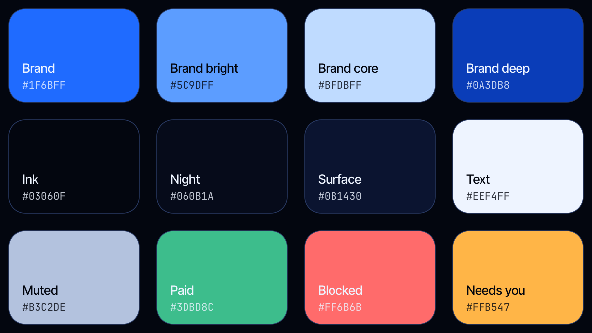

# Tally brand kit

Everything in this folder is generated from the app's own theme (`app/app/src/main/java/app/tally/ui/theme/Theme.kt`), so the kit and the product never drift.

<picture>
  <source media="(prefers-color-scheme: dark)" srcset="logo-lockup-dark.png">
  
</picture>

## Files

| File | Use |
| --- | --- |
| `logo-lockup-dark.png` / `.svg`, `logo-lockup-light.png` / `.svg` | The official lockup: the app icon beside "Tally" in Inter Tight Semibold, `#EEF4FF` for dark backgrounds and Ink `#03060F` for light ones. README hero, decks, social cards. The SVG embeds the 192 px icon. |
| `mark.svg` / `mark.png` | The Tally mark: four strokes and the fifth across, white on the brand gradient. App header, favicons, social avatars. |
| `mark-mono.svg`, `mark-mono-white.svg` | Single-colour mark for print, watermarks and the Android monochrome icon. |
| `wordmark-dark.svg`, `wordmark-light.svg` | Mark + "Tally" in Inter Tight Medium, for dark and light backgrounds. |
| `app-icon-1024.png`, `-512`, `-192` | The launcher icon (mascot behind the mark) with rounded corners and transparency. Store listings, README, decks. |
| `mascot.png` | The mascot, transparent, 1024 px tall. Use in illustrations, never as the logo. |
| `palette.svg` / `palette.png` | The colour sheet below. |

## Colour

| Token | Hex | Role |
| --- | --- | --- |
| Brand | `#1F6BFF` | The one primary action per screen, the mark, links. |
| Brand bright | `#5C9DFF` | Accent text, focus, selected tab mark. |
| Brand core | `#BFDBFF` | The hot centre of orbs and the lit edge of progress bars. |
| Brand deep | `#0A3DB8` | Shadows inside blue, the bottom of gradients. |
| Ink | `#03060F` | The ground every screen sits on. |
| Night / Surface | `#060B1A` / `#0B1430` | Sheets and dialogs. |
| Text / Muted / Faint | `#EEF4FF` / `#B3C2DE` / `#7F90B5` | Three steps of text, nothing in between. |
| Paid | `#3DBD8C` | Small check marks only. Amounts are set in Text, never in green. |
| Blocked | `#FF6B6B` | Refused payments, red-team results. |
| Needs you | `#FFB547` | Anything waiting for the owner's tap. |

Glass is `#040A1C` at 56% over the backdrop with a 1 px hairline that fades from `#C2DCFF` at 22% (top) to 6% (bottom).

## Type

**Inter Tight** (variable, OFL). Large statements are Light (300) with tight tracking: 46/40/32 px at −1.2/−1.0/−0.7. Labels are Medium (500); buttons Semibold (600). Figures are Light too, never bold. Code and addresses: JetBrains Mono.

## Light

Three backdrops, all brand blue over Ink with a film grain:

- **Dawn**: light pouring from the top. Home.
- **Night**: a dark field lit at the top and both edges. Scan, checkout, rules, merchant.
- **Dusk**: Night at half strength. Receipts, rewards, settings.

## Rules

- The mark is the logo. The mascot is a character: it may appear beside content, it never replaces the mark and it never bounces.
- One lit (blue) button per screen. Everything else is glass.
- Semantic colours keep one meaning everywhere: green = paid, red = blocked, amber = needs you.
- No drop shadows on cards; the hairline does that work.
- Don't put the mark on a non-brand gradient or recolour it.
